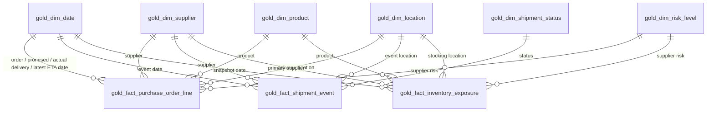

# Gold data model - Team 4 Supply Chain Disruption Analytics

_Generated from `src/gold/` - do not edit by hand._

## Star schema

Surrogate keys are `xxhash64(natural key)` (deterministic across refreshes). Every dimension has an Unknown member with key -1; date keys are yyyyMMdd. Role-playing dates on the PO-line fact: one active relationship (order date), the others inactive and activated with USERELATIONSHIP.

## Grain

| Fact | Grain |
|---|---|
| `gold_fact_purchase_order_line` | one purchase-order line (current version, cancelled lines excluded) |
| `gold_fact_shipment_event` | one shipment status event |
| `gold_fact_inventory_exposure` | one product at snapshot_date |

## KPIs (business_brief.md section 4) and their DAX measures

| KPI | Brief formula | DAX measure |
|---|---|---|
| Order Value | SUM(ordered_qty x unit_price x rate_to_eur) | `SUMX(gold_fact_purchase_order_line, [ordered_qty] * [unit_price] * [rate_to_eur])` |
| On-Time Delivery Rate | count(lines where is_on_time) / count(lines where is_delivered) | `DIVIDE(CALCULATE(COUNTROWS(gold_fact_purchase_order_line), gold_fact_purchase_order_line[is_on_time]), CALCULATE(COUNTROWS(gold_fact_purchase_order_line), gold_fact_purchase_order_line[is_delivered]))` |
| Average Delay (days) | AVG(actual_delivery_date - promised_delivery_date) where is_delivered AND delay_days > 0 | `AVERAGEX(FILTER(gold_fact_purchase_order_line, [is_delivered] && [delay_days] > 0), [delay_days])` |
| Supplier Fill Rate | SUM(MIN(received_qty, ordered_qty)) / SUM(ordered_qty) where promised_delivery_date <= snapshot_date | `VAR s = MAX(gold_fact_inventory_exposure[snapshot_date_key]) VAR due = FILTER(gold_fact_purchase_order_line, [promised_delivery_date_key] <= s) RETURN DIVIDE(SUMX(due, MIN([received_qty], [ordered_qty])), SUMX(due, [ordered_qty]))` |
| Exposed Value | SUM(delayed_inbound_qty x unit_cost x rate_to_eur) where days_of_cover < days_until_arrival | `SUMX(FILTER(gold_fact_inventory_exposure, NOT ISBLANK([days_of_cover]) && NOT ISBLANK([days_until_arrival]) && [days_of_cover] < [days_until_arrival]), [delayed_inbound_qty] * [unit_cost] * [rate_to_eur])` |
| Delayed Quantity | SUM(delayed_qty) | `SUM(gold_fact_purchase_order_line[delayed_qty])` |
| Critical-Item Count | DISTINCTCOUNT(product_id) where criticality = 'CRITICAL' AND delayed_inbound_qty > 0 | `CALCULATE(DISTINCTCOUNT(gold_fact_inventory_exposure[product_key]), gold_dim_product[criticality] = "CRITICAL", gold_fact_inventory_exposure[delayed_inbound_qty] > 0)` |
| Alternate-Supplier Coverage | count(CRITICAL products where has_active_alternate) / count(CRITICAL products) | `DIVIDE(CALCULATE(COUNTROWS(gold_dim_product), gold_dim_product[criticality] = "CRITICAL", gold_dim_product[has_active_alternate]), CALCULATE(COUNTROWS(gold_dim_product), gold_dim_product[criticality] = "CRITICAL"))` |

## Derived fields stored in Gold

| Field | Brief definition |
|---|---|
| `received_qty` | SUM(items[].quantity) from DELIVERED events for the PO line |
| `is_delivered` | received_qty >= ordered_qty OR line_status = 'CLOSED' |
| `actual_delivery_date` | Date of the last DELIVERED event for the PO line |
| `delay_days` | Delivered: actual_delivery_date - promised_delivery_date; open and past due: snapshot_date - promised_delivery_date; otherwise 0 |
| `is_on_time` | is_delivered AND actual_delivery_date <= promised_delivery_date |
| `is_delayed` | (is_delivered AND delay_days > 0) OR (NOT is_delivered AND (promised_delivery_date <= snapshot_date OR latest_eta_date > promised_delivery_date)) |
| `delayed_qty` | Past due: ordered_qty - qty received by promised_delivery_date; not yet due with late ETA: ordered_qty - received_qty; otherwise 0 |
| `delayed_inbound_qty` | SUM(delayed_qty) of open delayed lines for the product |
| `days_of_cover` | MAX(0, on_hand_qty - safety_stock_qty) / avg_daily_demand |
| `days_until_arrival` | latest_eta_date of earliest delayed open line - snapshot_date; if no ETA, delay_days + contract_lead_time_days |
| `has_active_alternate` | alternate_supplier_id is not null AND <> primary_supplier_id AND alternate supplier is_active |

## Delta layout

`gold_fact_purchase_order_line` is clustered by (`order_date_key`, `supplier_key`) and `gold_fact_shipment_event` by (`event_date_key`, `supplier_key`): the report filters by period and supplier, so liquid clustering lets Databricks skip files on those predicates. Dimensions and the 300-row exposure snapshot are read whole and are not clustered.

## Tables and columns

### `gold_fact_purchase_order_line`

Grain: one purchase-order line (current version, cancelled lines excluded). KPIs: Order Value, On-Time Delivery Rate, Average Delay, Supplier Fill Rate, Delayed Quantity

| Column | Description | Sensitivity |
|---|---|---|
| `po_id` | Purchase order identifier | Internal |
| `po_line_number` | Line number within the purchase order | Internal |
| `supplier_key` | Surrogate key -> gold_dim_supplier (-1 = unknown) | Internal |
| `product_key` | Surrogate key -> gold_dim_product (-1 = unknown) | Internal |
| `location_key` | Destination warehouse (delivery_location_id) -> gold_dim_location | Internal |
| `risk_level_key` | Supplier risk_rating -> gold_dim_risk_level (-1 = unknown) | Internal |
| `order_date_key` | order_date -> gold_dim_date | Internal |
| `promised_delivery_date_key` | promised_delivery_date -> gold_dim_date | Internal |
| `actual_delivery_date_key` | actual_delivery_date -> gold_dim_date (-1 = not delivered) | Internal |
| `latest_eta_date_key` | latest_eta_date -> gold_dim_date (-1 = no shipment event) | Internal |
| `line_status` | OPEN, PARTIALLY_RECEIVED, CLOSED | Internal |
| `ordered_qty` | Quantity ordered | Internal |
| `unit_price` | Agreed price per unit (line currency) | Confidential |
| `rate_to_eur` | FX rate to EUR valid on order_date (fx_rates) | Internal |
| `received_qty` | Brief: SUM(items[].quantity) from DELIVERED events for the PO line | Internal |
| `delay_days` | Brief: delivered -> actual - promised; open and past due -> snapshot - promised; else 0 | Internal |
| `delayed_qty` | Brief: past due -> ordered - qty received by promised date; not yet due with late ETA -> ordered - received; else 0 | Internal |
| `is_delivered` | Brief: received_qty >= ordered_qty OR line_status = 'CLOSED' | Internal |
| `is_on_time` | Brief: is_delivered AND actual_delivery_date <= promised_delivery_date | Internal |
| `is_delayed` | Brief: (delivered AND delay_days > 0) OR (not delivered AND (past due OR latest ETA after promised)) | Internal |

### `gold_fact_shipment_event`

Grain: one shipment status event

| Column | Description | Sensitivity |
|---|---|---|
| `event_id` | Unique event identifier | Internal |
| `shipment_id` | Shipment the event belongs to | Internal |
| `po_id` | Purchase order being shipped | Internal |
| `shipment_status_key` | Surrogate key -> gold_dim_shipment_status (-1 = unknown) | Internal |
| `supplier_key` | Supplier of the purchase order -> gold_dim_supplier | Internal |
| `location_key` | Event location -> gold_dim_location | Internal |
| `event_date_key` | Event date (UTC) -> gold_dim_date | Internal |
| `carrier` | Logistics carrier name | Internal |
| `delay_reason_code` | Reason for delay (nullable) | Internal |
| `event_ts` | Time the status occurred (UTC) | Internal |
| `eta_ts` | Carrier's estimated arrival time (UTC) | Internal |

### `gold_fact_inventory_exposure`

Grain: one product at snapshot_date. KPIs: Exposed Value, Critical-Item Count

| Column | Description | Sensitivity |
|---|---|---|
| `snapshot_date_key` | snapshot_date (as-of date of the refresh) -> gold_dim_date | Internal |
| `product_key` | Surrogate key -> gold_dim_product (-1 = unknown) | Internal |
| `supplier_key` | Primary supplier -> gold_dim_supplier | Internal |
| `location_key` | Stocking warehouse -> gold_dim_location | Internal |
| `risk_level_key` | Supplier risk_rating -> gold_dim_risk_level (-1 = unknown) | Internal |
| `on_hand_qty` | Stock on hand at extract time | Internal |
| `safety_stock_qty` | Minimum stock to be held as buffer | Internal |
| `avg_daily_demand` | Average units consumed per day | Confidential |
| `unit_cost` | Standard cost per unit | Confidential |
| `rate_to_eur` | FX rate to EUR of cost_currency valid on snapshot_date (fx_rates) | Internal |
| `days_of_cover` | Brief: MAX(0, on_hand_qty - safety_stock_qty) / avg_daily_demand | Internal |
| `delayed_inbound_qty` | Brief: SUM(delayed_qty) of open delayed lines for the product | Internal |
| `days_until_arrival` | Brief: latest_eta_date of earliest delayed open line - snapshot_date; if no ETA, delay_days + contract_lead_time_days | Internal |

### `gold_dim_date`

Date dimension; date_key = yyyyMMdd, -1 = unknown

| Column | Description | Sensitivity |
|---|---|---|
| `date_key` | Surrogate key yyyyMMdd | Internal |
| `date` | Calendar date | Internal |
| `year` | Year | Internal |
| `quarter` | Quarter 1-4 | Internal |
| `month` | Month 1-12 | Internal |
| `month_name` | Month name | Internal |

### `gold_dim_supplier`

Suppliers (current snapshot)

| Column | Description | Sensitivity |
|---|---|---|
| `supplier_key` | Surrogate key -> gold_dim_supplier (-1 = unknown) | Internal |
| `supplier_id` | Unique supplier identifier | Internal |
| `supplier_name` | Legal or trading name of the supplier | Internal |
| `country_code` | ISO 3166-1 alpha-2 country of the supplier | Public |
| `region` | EMEA, APAC, AMER | Public |
| `default_currency` | ISO 4217 currency used by the supplier | Internal |
| `contract_lead_time_days` | Contractually agreed lead time in days | Confidential |
| `risk_rating` | LOW, MEDIUM, HIGH | Confidential |
| `is_active` | Whether the supplier is currently approved for ordering | Internal |
| `onboarded_date` | Date the supplier was approved | Internal |

### `gold_dim_product`

Products (current snapshot)

| Column | Description | Sensitivity |
|---|---|---|
| `product_key` | Surrogate key -> gold_dim_product (-1 = unknown) | Internal |
| `product_id` | Unique product identifier | Internal |
| `product_name` | Product description | Public |
| `category` | Product category | Public |
| `unit_of_measure` | EA, KG, L | Public |
| `criticality` | CRITICAL, HIGH, MEDIUM, LOW | Internal |
| `primary_supplier_id` | Main supplier for the product | Internal |
| `alternate_supplier_id` | Approved backup supplier | Internal |
| `stocking_location_id` | Primary warehouse holding the product | Internal |
| `has_active_alternate` | Brief: alternate_supplier_id not null AND <> primary_supplier_id AND alternate supplier is_active | Internal |

### `gold_dim_location`

Locations of shipment events and warehouses referenced by PO lines / products

| Column | Description | Sensitivity |
|---|---|---|
| `location_key` | Surrogate key -> gold_dim_location (-1 = unknown) | Internal |
| `location_id` | Location identifier | Internal |
| `location_name` | Location name | Public |
| `location_country` | ISO 3166-1 alpha-2 country of the location | Public |
| `location_type` | WAREHOUSE, PORT, HUB, SUPPLIER_SITE | Public |

### `gold_dim_shipment_status`

Shipment statuses (data dictionary)

| Column | Description | Sensitivity |
|---|---|---|
| `shipment_status_key` | Surrogate key -> gold_dim_shipment_status (-1 = unknown) | Internal |
| `status` | Shipment status | Internal |

### `gold_dim_risk_level`

Supplier risk levels (data dictionary risk_rating)

| Column | Description | Sensitivity |
|---|---|---|
| `risk_level_key` | Supplier risk_rating -> gold_dim_risk_level (-1 = unknown) | Internal |
| `risk_level` | LOW, MEDIUM, HIGH | Internal |
